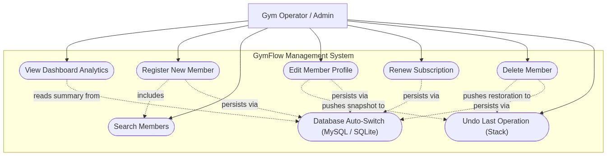
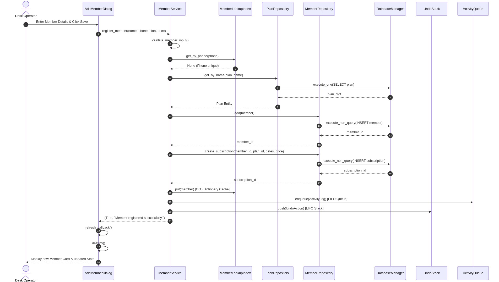
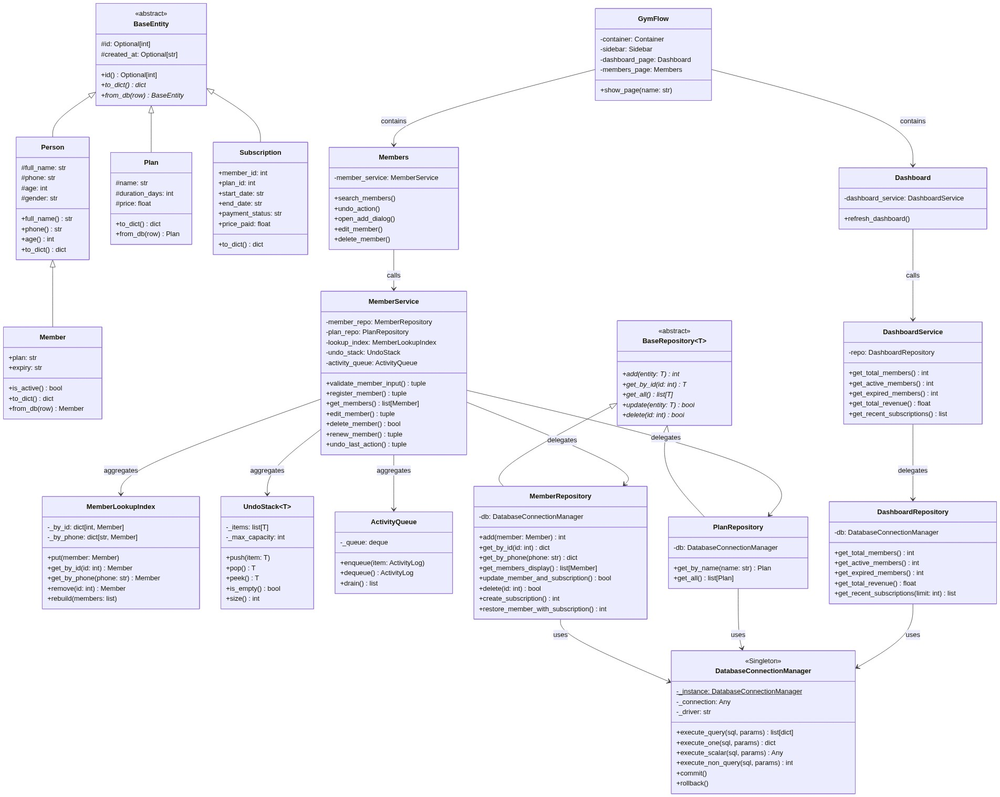
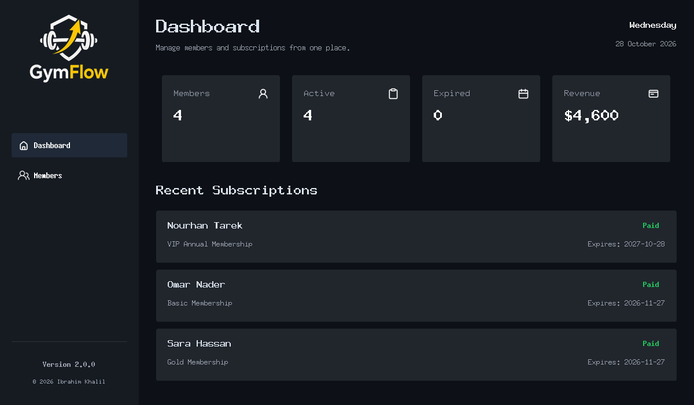
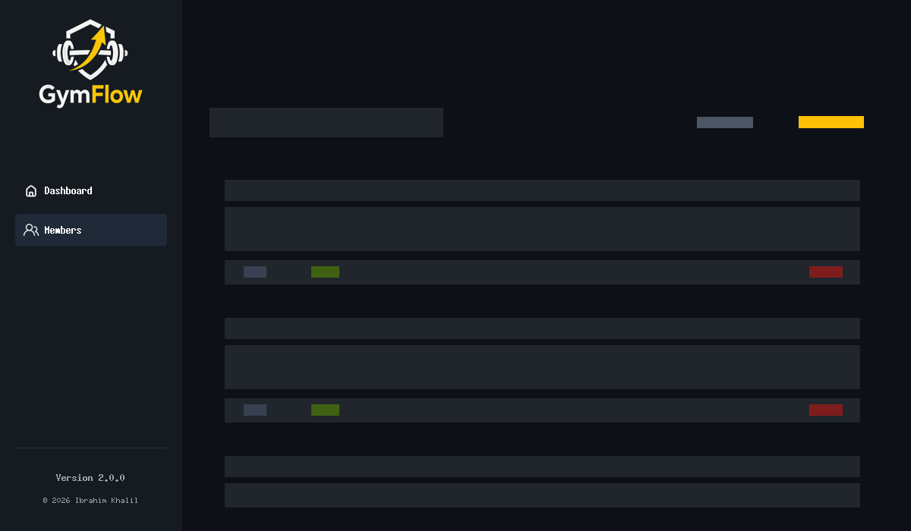
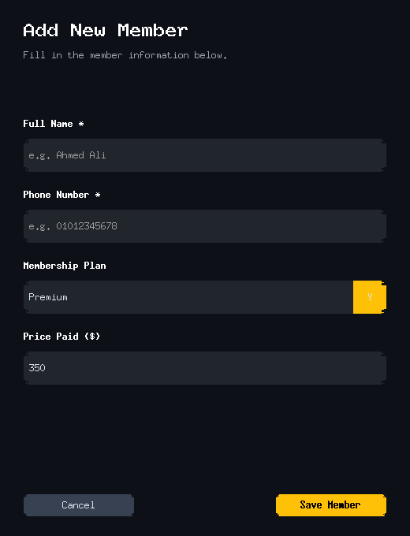
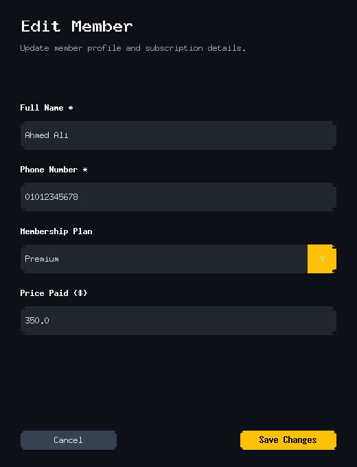

# GymFlow-v2: Advanced Gym Management System

[](https://www.python.org/)
[](https://github.com/TomSchimansky/CustomTkinter)
[](https://www.mysql.com/)
[](tests/)
[](#4-software-architecture-layered-architecture)
[](#5-software-design-patterns)

> **Session 9 Software Engineering Assignment Completion**  
> **Author:** Ibrahim Khalil  
> **Repository:** [Mtgazer/GymFLow-v2](https://github.com/Mtgazer/GymFLow-v2)  
> **Branch:** `feature/session-9-completion`  

---

## 1. Project Overview & Motivation

GymFlow-v2 is an enterprise-grade desktop gym management application written in Python using CustomTkinter. The system provides gym administrators and desk receptionists with a centralized, responsive interface to manage memberships, subscriptions, financial tracking, and real-time analytical metrics.

### Problem Statement
Fitness facilities frequently struggle with either over-complicated, recurring-fee SaaS web portals that require continuous high-speed internet or fragile, unstructured Excel spreadsheets prone to corruption and human error. GymFlow-v2 bridges this gap by delivering a lightning-fast, secure, offline-capable desktop application backed by enterprise MySQL permanent data storage, transactional integrity, and native undo recovery.

---

## 2. Core Project Features

- **Full CRUD Management:** Seamless Create, Read, Update, and Delete operations for gym members and subscription plans with real-time UI refresh.
- **Dynamic Dashboard Analytics:** Real-time calculation of total members, active members, expired subscriptions, gross collected revenue, and recent subscription activity.
- **Fast Search & Live Filtering:** In-memory $O(1)$ dictionary index for searching members by name or phone number with immediate results.
- **LIFO Undo Operations:** Bounded Undo Stack (`UndoStack`) allowing operators to reverse the most recent member deletion, profile update, or registration with a single click.
- **Enterprise MySQL Integration:** Permanent relational database integration with parameterized queries, `.env` configuration, and automatic, transparent fallback to local SQLite when operating offline.
- **Modal Dialog Validation:** Comprehensive in-dialog input validation with error banners (validating names, phone formats, and numeric pricing).

---

## 3. Technologies Used

| Technology / Tool | Version | Purpose in GymFlow-v2 |
| :--- | :--- | :--- |
| **Python** | 3.12+ | Core programming language |
| **CustomTkinter** | >= 6.0.0 | Modern desktop GUI framework with dark-mode aesthetic styling |
| **Pillow (PIL)** | >= 10.0.0 | High-performance image loading and icon scaling |
| **MySQL Connector & PyMySQL** | >= 8.0.0 | Enterprise relational database connectivity |
| **SQLite3** | Built-in | Zero-config embedded database engine for offline resilience |
| **python-dotenv** | >= 1.0.0 | Secure environment variable configuration from `.env` |
| **pytest** | >= 8.0.0 | Comprehensive unit and integration test suite |
| **ReportLab** | >= 4.0.0 | Automated PDF engineering report generation |
| **Mermaid.js** | 10+ | Declarative UML diagram specification |

---

## 4. Software Architecture: Layered Architecture

GymFlow-v2 implements a strict **4-Layered Architecture** enforcing separation of concerns and unidirectional dependency flow:

```
┌─────────────────────────────────────────────────────────────┐
│                    PRESENTATION LAYER                       │
│      (CustomTkinter GUI: Sidebar, Dashboard, Members)       │
└──────────────────────────────┬──────────────────────────────┘
                               │ Calls
▼
┌─────────────────────────────────────────────────────────────┐
│                   BUSINESS LOGIC LAYER                      │
│     (Application Services: MemberService, DashboardService)  │
│     (Data Structures: MemberLookupIndex, UndoStack, Queue)  │
└──────────────────────────────┬──────────────────────────────┘
                               │ Delegates
▼
┌─────────────────────────────────────────────────────────────┐
│                     DATA ACCESS LAYER                       │
│    (Repositories: MemberRepository, PlanRepository, etc.)   │
│       (Connection Singleton: DatabaseConnectionManager)      │
└──────────────────────────────┬──────────────────────────────┘
                               │ Queries
▼
┌─────────────────────────────────────────────────────────────┐
│                  DATABASE / PERSISTENCE LAYER               │
│           (MySQL Database Engine  /  SQLite Fallback)        │
└─────────────────────────────────────────────────────────────┘
```

1. **Presentation Layer (`ui/`):** GUI widgets, frames, and dialogs. Strictly isolated from SQL queries and database drivers.
2. **Business Logic Layer (`services/`):** Domain validation, subscription duration logic, undo stack dispatching, and index cache updates.
3. **Data Access Layer (`repositories/`):** Encapsulates all query formulation, transactions, and parameterization via the Repository Pattern.
4. **Domain / Model Layer (`models.py`):** Pure entity objects (`Member`, `Person`, `Plan`, `Subscription`, `BaseEntity`).

---

## 5. Software Design Patterns

### A. Repository Pattern
- **Problem Solved:** Prevents tight coupling between application business rules and specific SQL database engines.
- **Implementation:** Abstract base class `BaseRepository[T]` defines standard generic CRUD operations (`add`, `get_by_id`, `get_all`, `update`, `delete`). Concrete implementations (`MemberRepository`, `PlanRepository`, `DashboardRepository`) implement database operations using parameterized queries.
- **Collaboration:** `MemberService` interacts exclusively with repositories; switching between MySQL and SQLite requires zero changes to business logic or UI code.

### B. Singleton Pattern
- **Problem Solved:** Eliminates redundant database connections and prevents race conditions during multi-threaded access.
- **Implementation:** `DatabaseConnectionManager` uses a thread-safe double-checked lock (`threading.Lock`) over `__new__`.
- **Collaboration:** Repositories share the unified singleton connection across the entire application lifecycle.

---

## 6. Domain-Specific Data Structures

GymFlow-v2 incorporates three specialized data structures in `core/data_structures.py`:

| Data Structure | Class Name | Time Complexity | Operational Rationale |
| :--- | :--- | :--- | :--- |
| **Dictionary (Hash Map)** | `MemberLookupIndex` | Lookups: **$O(1)$**<br/>Insertions: **$O(1)$**<br/>Removals: **$O(1)$** | Maintains dual hash indices by member ID and phone number. Enables instant search filtering and duplicate phone checks without repeated database roundtrips. |
| **Stack (LIFO)** | `UndoStack[UndoAction]` | Push: **$O(1)$**<br/>Pop: **$O(1)$**<br/>Peek: **$O(1)$** | Bounded stack (capacity 50) that tracks user mutations. Allows operators to reverse accidental member deletions, updates, or registrations in Last-In, First-Out sequence. |
| **Queue (FIFO)** | `ActivityQueue` | Enqueue: **$O(1)$**<br/>Dequeue: **$O(1)$** | Chronological First-In, First-Out audit log tracking administrative events (registrations, renewals, deletes) for compliance and auditing. |

---

## 7. Object-Oriented Programming (OOP) Principles

- **Abstraction:** Abstract Base Classes (`BaseEntity`, `BaseRepository`) define strict public contracts using `@abstractmethod`, hiding underlying database syntax and serialization complexities.
- **Inheritance:** Clean class hierarchy: `BaseEntity` &rarr; `Person` &rarr; `Member`. `Member` inherits identity tracking from `BaseEntity` and demographic attributes from `Person`.
- **Encapsulation:** Protected fields (`_full_name`, `_phone`, `_age`) are accessed and modified exclusively through `@property` getters and setters with validation rules.
- **Polymorphism:** Polymorphic serialization (`to_dict`) and instantiation (`from_db`) allow uniform handling of entities across repositories and data structures.

---

## 8. Database Schema & MySQL Integration

### Relational Schema (`database/schema.sql`)

```
   ┌────────────────────┐          1:N          ┌──────────────────────────┐
   │      members       │──────────────────────<│      subscriptions       │
   ├────────────────────┤                       ├──────────────────────────┤
   │ id (PK)            │                       │ id (PK)                  │
   │ full_name          │                       │ member_id (FK -> members)│
   │ phone (UNIQUE)     │                       │ plan_id (FK -> plans)    │
   │ age                │                       │ start_date               │
   │ gender             │                       │ end_date                 │
   │ created_at         │                       │ payment_status           │
   └────────────────────┘                       │ price_paid               │
                                                │ created_at               │
   ┌────────────────────┐          1:N          └─────────────┬────────────┘
   │       plans        │─────────────────────────────────────┘
   ├────────────────────┤
   │ id (PK)            │
   │ name (UNIQUE)      │
   │ duration_days      │
   │ price              │
   │ created_at         │
   └────────────────────┘
```

### MySQL Security & Offline Fallback
- **No Hardcoded Passwords:** All credentials (`DB_HOST`, `DB_PORT`, `DB_USER`, `DB_PASSWORD`, `DB_NAME`) are read from environment variables via `python-dotenv`.
- **Parameterized Queries:** All SQL calls use parameterized inputs (`%s` / `?`), preventing SQL injection.
- **Automatic Fallback:** If the MySQL daemon is unreachable (e.g., during offline demo), GymFlow logs a notice and seamlessly continues using local SQLite (`gym.db`).

---

## 9. Installation & Setup Guide

### Prerequisites
- Python 3.12 or newer
- (Optional) MySQL Server 8.0+

### Step 1: Clone the Repository
```bash
git clone https://github.com/Mtgazer/GymFLow-v2.git
cd GymFLow-v2
git checkout feature/session-9-completion
```

### Step 2: Create and Activate Virtual Environment
```bash
# Using standard Python
python3 -m venv .venv
source .venv/bin/activate

# Or using Astral uv (fast)
uv venv --python 3.12 .venv
source .venv/bin/activate
```

### Step 3: Install Dependencies
```bash
pip install -r requirements.txt
```

### Step 4: Configure Environment Variables
Copy the example configuration to `.env`:
```bash
cp .env.example .env
```
Edit `.env` with your MySQL database credentials:
```ini
DB_TYPE=mysql
DB_HOST=localhost
DB_PORT=3306
DB_USER=gym_user
DB_PASSWORD=gym_password
DB_NAME=gym_flow
SQLITE_FALLBACK=true
```

### Step 5: Initialize the Database
Run the database initialization script to create tables and seed default membership plans:
```bash
python database/init_db.py
```

### Step 6: Launch the Application
```bash
python app.py
```

---

## 10. Automated Testing

GymFlow-v2 includes a comprehensive test suite covering domain models, data structures, repositories, services, and design patterns:

```bash
# Run all automated tests
pytest -v

# Run specific test modules
pytest tests/test_models.py -v
pytest tests/test_data_structures.py -v
pytest tests/test_patterns.py -v
pytest tests/test_repositories.py -v
pytest tests/test_services.py -v
```

### Test Suite Execution Summary
```
============================== test session starts ==============================
collected 27 items

tests/test_data_structures.py::TestDataStructures::test_member_lookup_index_operations PASSED [  3%]
tests/test_data_structures.py::TestDataStructures::test_undo_stack_lifo_order PASSED          [  7%]
tests/test_data_structures.py::TestDataStructures::test_undo_stack_capacity_eviction PASSED  [ 11%]
tests/test_data_structures.py::TestDataStructures::test_activity_queue_fifo_order PASSED      [ 14%]
tests/test_data_structures.py::TestDataStructures::test_activity_queue_drain PASSED           [ 18%]
tests/test_models.py::TestOOPModels::test_inheritance_hierarchy PASSED                        [ 22%]
tests/test_models.py::TestOOPModels::test_person_encapsulation_and_validation PASSED          [ 25%]
tests/test_models.py::TestOOPModels::test_member_attributes_and_active_status PASSED          [ 29%]
tests/test_models.py::TestOOPModels::test_member_serialization_and_deserialization PASSED    [ 33%]
tests/test_models.py::TestOOPModels::test_plan_encapsulation_and_validation PASSED            [ 37%]
tests/test_models.py::TestOOPModels::test_subscription_creation PASSED                        [ 40%]
tests/test_patterns.py::TestDesignPatterns::test_singleton_identity PASSED                   [ 44%]
tests/test_patterns.py::TestDesignPatterns::test_singleton_thread_safety PASSED              [ 48%]
tests/test_patterns.py::TestDesignPatterns::test_repository_pattern_conformance PASSED       [ 51%]
tests/test_patterns.py::TestDesignPatterns::test_layered_architecture_isolation PASSED        [ 55%]
tests/test_patterns.py::TestDesignPatterns::test_mysql_connection_mock PASSED                [ 59%]
tests/test_patterns.py::TestDesignPatterns::test_mysql_fallback_to_sqlite PASSED             [ 62%]
tests/test_repositories.py::TestRepositories::test_plan_repository_crud PASSED              [ 66%]
tests/test_repositories.py::TestRepositories::test_member_repository_crud_and_subscriptions PASSED [ 70%]
tests/test_repositories.py::TestRepositories::test_dashboard_repository_metrics PASSED       [ 74%]
tests/test_services.py::TestServices::test_input_validation PASSED                            [ 77%]
tests/test_services.py::TestServices::test_register_member_and_undo PASSED                   [ 81%]
tests/test_services.py::TestServices::test_duplicate_phone_prevention PASSED                 [ 85%]
tests/test_services.py::TestServices::test_edit_and_undo PASSED                               [ 88%]
tests/test_services.py::TestServices::test_delete_and_undo PASSED                             [ 92%]
tests/test_services.py::TestServices::test_renew_member PASSED                                [ 96%]
tests/test_services.py::TestServices::test_dashboard_service_summary PASSED                  [100%]

============================== 27 passed in 0.28s ==============================
```

---

## 11. UML Diagrams

Diagram sources are located in `docs/uml/` and can be regenerated via `python docs/uml/render_diagrams.py`:

| Diagram | Source File | Rendered Image | Description |
| :--- | :--- | :--- | :--- |
| **Use Case Diagram** | [`docs/uml/use_case_diagram.mmd`](docs/uml/use_case_diagram.mmd) |  | Operator interactions with members, analytics, and undo actions |
| **Sequence Diagram** | [`docs/uml/sequence_diagram.mmd`](docs/uml/sequence_diagram.mmd) |  | Member registration flow across GUI, Service, Repositories, and DB |
| **Class Diagram** | [`docs/uml/class_diagram.mmd`](docs/uml/class_diagram.mmd) |  | Static class architecture, inheritance, and layer relationships |

---

## 12. Application Screenshots

Actual screen captures from the running application:

| View | Screenshot |
| :--- | :--- |
| **Dashboard Page** |  |
| **Members Management & Undo** |  |
| **Add Member Modal Dialog** |  |
| **Edit Member Modal Dialog** |  |

---

## 13. Project Audit & Deliverables

- Detailed requirements audit: [`PROJECT_AUDIT.md`](PROJECT_AUDIT.md)
- Complete 6-page PDF Report: [`GymFlow_Session9_Report.pdf`](GymFlow_Session9_Report.pdf)
- Database Initialization: [`database/init_db.py`](database/init_db.py)
- MySQL Schema: [`database/schema.sql`](database/schema.sql)
- Configuration Template: [`.env.example`](.env.example)

---

## 14. License & Credits

- **Original Author:** Ibrahim Khalil
- **Course Assignment:** Session 9 Software Engineering
- **Year:** 2026
